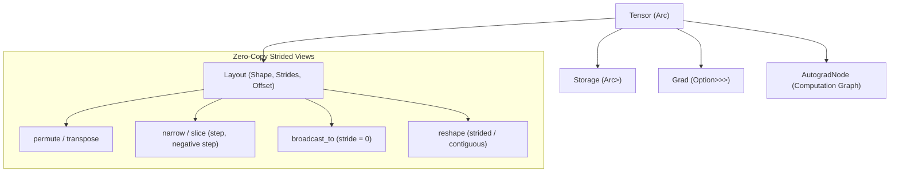
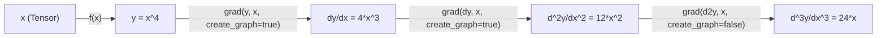
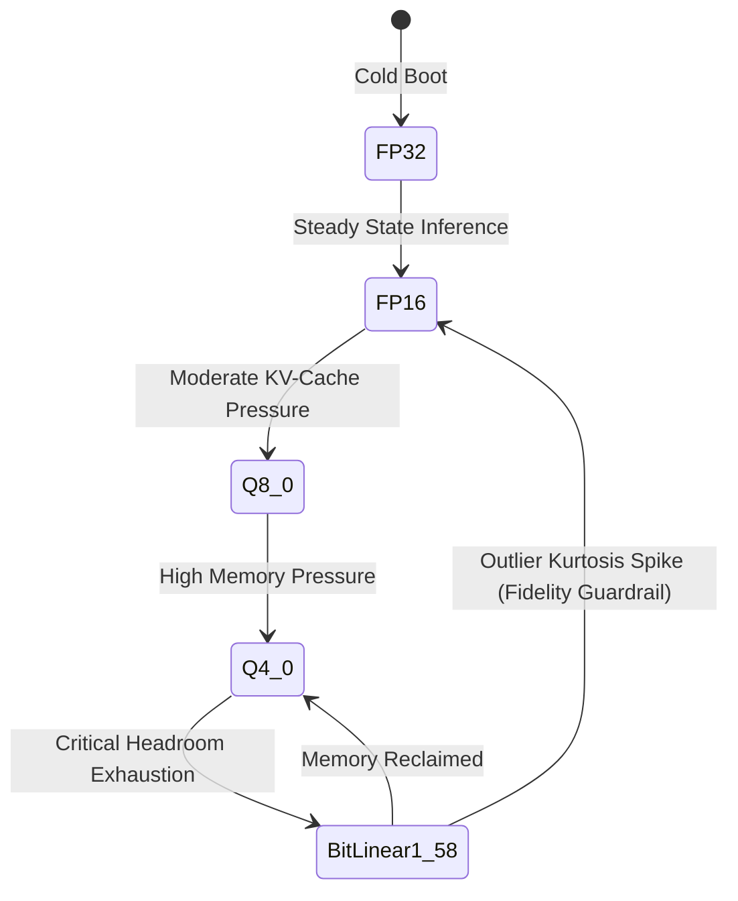
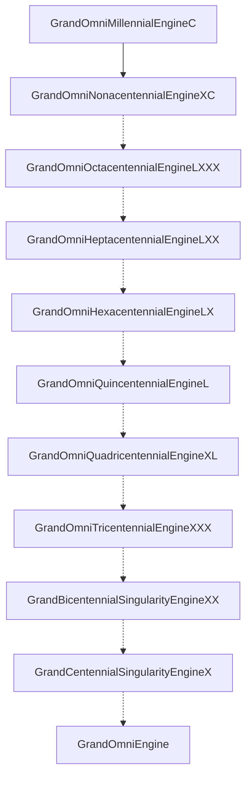
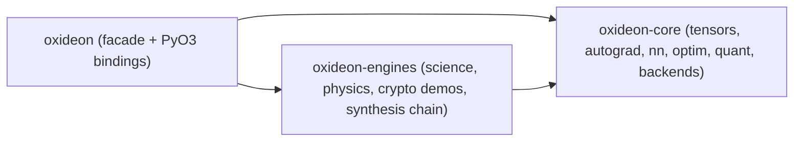
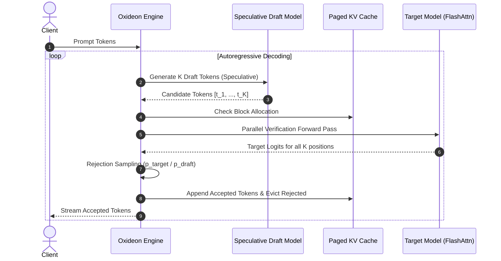
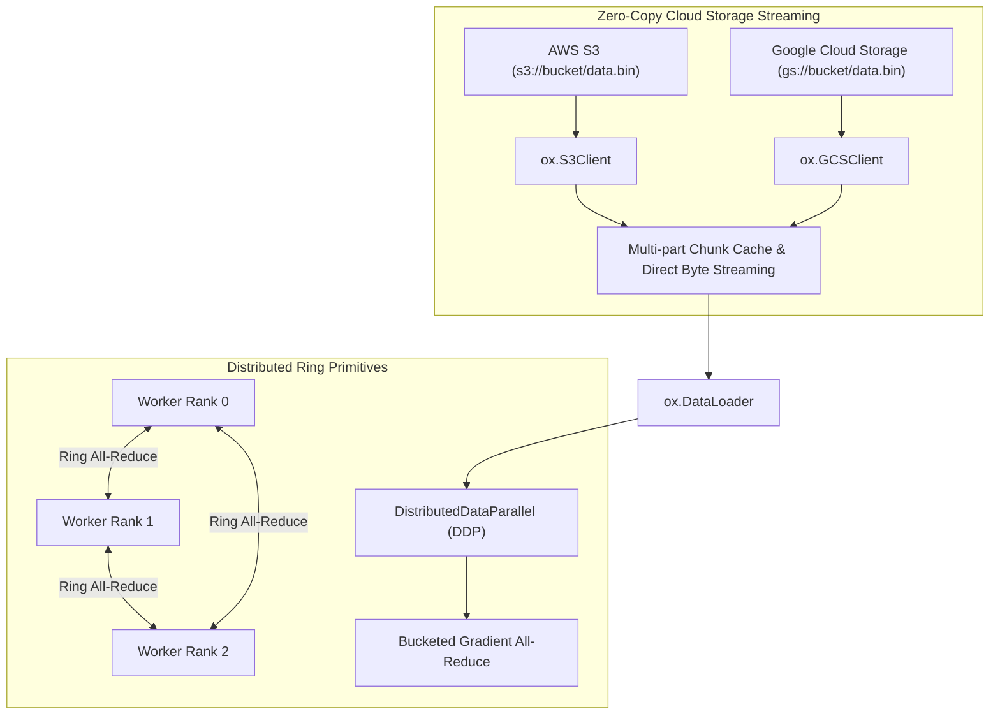

# Oxideon Architecture & System Design

**Crate version:** `0.1.1` · **Engines:** 1,000 (The Millennial Singularity Apex, see [ENGINES_CATALOG.md](ENGINES_CATALOG.md))  
**Edition:** Rust 2024 (1.85+) | **Python ABI:** CPython `abi3` ($\ge 3.9$)  
**Core Features:** Zero-Copy Strided Views, Higher-Order Autograd, Symbolic Graph Compiler, Autonomous LLM Quantization, Paged Attention & Speculative Decoding, Cloud Native Storage Streaming, 100 Decadal Milestone Syntheses, and Zero-GIL PyO3 Concurrency.

---

## 1. Unified Tensor Storage & Zero-Copy Strided Layouts

Oxideon's tensor engine is engineered around the principle of zero-copy mathematical transformations over contiguous or non-contiguous heap-allocated flat storage (`Storage`).

### Strided Memory Math
For an $N$-dimensional tensor with shape $(d_0, d_1, \dots, d_{N-1})$ and signed strides $(s_0, s_1, \dots, s_{N-1})$, the flat storage index corresponding to coordinates $(i_0, i_1, \dots, i_{N-1})$ is computed as:

$$\mathrm{Offset}(i_0, \dots, i_{N-1}) = \mathrm{offset}_0 + \sum_{k=0}^{N-1} i_k \cdot s_k$$

- **Broadcasting**: Dimensions with size $1$ can be expanded to size $D$ by setting $s_k = 0$, requiring zero memory duplication.
- **Negative Striding**: Slicing with negative steps or reversing axes via `flip` simply negates the corresponding stride and shifts $\mathrm{offset}_0$.
- **Unified Invertible ViewSpec**: Every view transformation preserves an invertible `view_scatter` operation, enabling automatic reverse-mode differentiation through all view manipulations without copying.

---

## 2. Multi-DType System

Oxideon natively supports 8 primitive numerical types across all unary, binary, and reduction kernels:

| DType | Bitwidth | Representation | Notes |
|---|---|---|---|
| `Bool` | 8-bit | Boolean flag | Masking and boolean logic |
| `U8` | 8-bit | Unsigned integer | Token IDs, quantization indices, image channels |
| `I32` | 32-bit | Signed integer | High-dimension indexing, discrete games |
| `I64` | 64-bit | Signed integer | Large-scale indexing, cryptographic moduli |
| `F16` | 16-bit | IEEE 754 half-precision | Neural network weights and activations |
| `BF16` | 16-bit | Brain floating point | Wide dynamic range for LLM training |
| `F32` | 32-bit | Single-precision float | Standard deep learning default |
| `F64` | 64-bit | Double-precision float | High-precision scientific PDEs and quantum invariants |

---

## 3. Higher-Order Functional Autograd & Symbolic Compilation

The autograd subsystem supports higher-order differentiation by expressing backward gradient rules in terms of differentiable `Tensor` operations.

---

## 4. Autonomous LLM Dynamic Quantization

The online quantization subsystem (`DynamicLlmQuantizer`) continuously tracks token-generation telemetry to orchestrate runtime precision transitions without restarting inference sessions.

Supported precision modes:
- Standard Block Quantization: `Q8_0`, `Q4_0`, `Q4_1`, `Q5_0`, `Q5_1`
- Modern K-Quants: `Q2_K`, `Q3_K`, `Q4_K`, `Q5_K`, `Q6_K`
- 1-Bit LLM Architectures: `BitLinear 1.58-bit` ($\{-1, 0, +1\}$ ternary weights)

---

## 5. The Millennial Singularity Architecture

Oxideon's 1,000 engines are structured as a 100-tier hierarchical decadal pyramid culminating in `GrandOmniMillennialEngineC`:

---

## 6. Crate Layout

`oxideon-core` never depends on the engine catalog, so tensor/nn users can depend on it alone. `oxideon-engines` addresses core modules as `crate::tensor`, `crate::error`, ... through a glob re-export of `oxideon-core` at its crate root. The facade re-exports both crates, so paths such as `oxideon::Tensor` and `oxideon::science::…` are the same as before the split.

---

## 7. LLM Serving & High-Throughput Inference Architecture

Oxideon features a state-of-the-art inference engine optimized for autoregressive transformer models, eliminating memory fragmentation and maximizing decode token throughput.

### Paged Attention (`PagedKVCache`)
Standard KV caching pre-allocates contiguous memory for maximum sequence length ($S_{\max}$), causing up to 60-80% memory fragmentation. Oxideon implements vLLM-style virtual memory paging:
- **Block Pool**: Physical memory is partitioned into uniform blocks of size $B$ (default 16 tokens).
- **Logical-to-Physical Block Table**: Sequences dynamically allocate physical block IDs on demand.
- **Zero-Copy Sharing**: Beam search candidates, prompt prefixes, and parallel decodes share physical blocks via copy-on-write reference counting.

### Speculative Decoding (`SpeculativeDraftDecoder`)
Accelerates large models (70B+) using a small draft model (1B-7B):
1. **Speculative Generation**: The draft model generates $\gamma$ candidate tokens autoregressively.
2. **Parallel Verification**: The target model evaluates all $\gamma$ tokens in a single parallel forward pass.
3. **Rejection Sampling**: Tokens are accepted with probability $\min\left(1, \frac{P_{\text{target}}(x)}{P_{\text{draft}}(x)}\right)$, strictly preserving the target model's output distribution.

### FlashAttention-2 Tiled Attention (`flash_attention_forward`)
Computes exact multi-head scaled dot-product attention without materializing the $O(S^2)$ attention matrix in global memory:
- **Online Softmax Tiling**: Streams over blocks of Query ($Q$), Key ($K$), and Value ($V$) tensors while maintaining running row maximums $m_i$ and normalizers $l_i$:
  $$m_i^{\text{new}} = \max(m_i, \max(S_{ij})), \quad l_i^{\text{new}} = e^{m_i - m_i^{\text{new}}} l_i + \sum e^{S_{ij} - m_i^{\text{new}}}$$
- **SIMD Causal Masking**: Automatically skips strictly upper-triangular tiles for autoregressive decoding.

---

## 8. Multi-Device, Cloud & Distributed Training System

Oxideon provides enterprise-grade cloud integrations and distributed communication primitives designed for multi-GPU, multi-node, and hybrid cloud clusters.

- **Cloud Direct Ingestion**: High-throughput authenticated streaming from Amazon S3 and Google Cloud Storage without downloading dataset archives to local disk.
- **Distributed Process Groups**: `OxMultiNodeProcessGroup` coordinates rank identification, rendezvous, and peer-to-peer ring topologies (`RingAllReduce`, `AllGather`, `Broadcast`, `ReduceScatter`).
- **Managed Platform Telemetry**: Built-in runtime detection for AWS SageMaker (`/opt/ml/`) and GCP Vertex AI (`AIP_MODEL_DIR`), alongside real-time metrics and checkpoint synchronization callbacks (`CloudMetricsCallback`, `CloudCheckpointCallback`).

---

## 9. Parameter-Efficient Fine-Tuning (PEFT) & Alignment

Oxideon implements state-of-the-art PEFT and preference alignment techniques to fine-tune foundation models efficiently with minimal memory overhead.

### Weight-Decomposed Low-Rank Adaptation (DoRA)
Standard LoRA updates weights via $W = W_0 + \frac{\alpha}{r} B A$, which couples directional and magnitude adjustments. DoRA decomposes weights into magnitude vector $m \in \mathbb{R}^{d_{\text{out}}}$ and directional matrix $V \in \mathbb{R}^{d_{\text{out}} \times d_{\text{in}}}$:

$$W = m \odot \frac{V + \Delta V}{\|V + \Delta V\|_c} = m \odot \frac{W_0 + \frac{\alpha}{r} B A}{\|W_0 + \frac{\alpha}{r} B A\|_c}$$

This matches full fine-tuning dynamics while training fewer than 1% of the original parameters.

### LoRA+ Asymmetric Dynamics (`LoRAPlusLinear`)
By setting the learning rate ratio $\lambda = \eta_B / \eta_A \gg 1$ (typically $2 \le \lambda \le 16$), LoRA+ corrects the feature learning imbalance inherent in standard low-rank adaptation, leading to up to 2x faster convergence.

### Preference Alignment Losses
- **Direct Preference Optimization (`DPOLoss`)**: Aligns models to human preferences directly on pairwise completions $(y_w, y_l)$ without reinforcement learning or separate reward model training:
  $$\mathcal{L}_{\text{DPO}} = -\log \sigma \left( \beta \log \frac{\pi_\theta(y_w | x)}{\pi_{\text{ref}}(y_w | x)} - \beta \log \frac{\pi_\theta(y_l | x)}{\pi_{\text{ref}}(y_l | x)} \right)$$
- **Odds Ratio Preference Optimization (`ORPOLoss`)**: Unifies supervised fine-tuning (SFT) and preference alignment into a single objective by penalizing log-odds ratios:
  $$\mathcal{L}_{\text{ORPO}} = \mathcal{L}_{\text{SFT}} + \lambda \cdot \mathcal{L}_{\text{OR}}$$
- **Kahneman-Tversky Optimization (`KTOLoss`)**: Grounds alignment in cumulative prospect theory for unpaired binary human feedback (upvoted vs downvoted):
  $$\mathcal{L}_{\text{KTO}} = \mathbb{E}_{y \in \mathcal{Y}_{\text{desirable}}}[1 - \sigma(\lambda_D)] + \mathbb{E}_{y \in \mathcal{Y}_{\text{undesirable}}}[1 - \sigma(\lambda_U)]$$

---

## 10. Scientific AI & Geometric Deep Learning Systems

Oxideon unifies frontier machine learning with scientific computing and geometric deep learning:

- **Causal Discovery (`notears_linear`)**: Learns directed acyclic graph (DAG) adjacency matrices from observational data via continuous non-convex optimization with the exact matrix exponential trace constraint:
  $$h(W) = \operatorname{tr}\left(e^{W \odot W}\right) - d = 0$$
- **Graph Kernels (`weisfeiler_lehman_kernel`, `random_walk_kernel`)**: Computes topological graph similarities using 1-WL subtree patterns and geometric random walk walks over Kronecker product graph adjacency matrices.
- **Deep Evidential Uncertainty (`evidential_regression_loss`, `evidential_classification_loss`)**: Estimates epistemic and aleatoric uncertainty simultaneously by parameterizing conjugate priors (Normal-Inverse-Gamma for continuous targets, Dirichlet for discrete classifications).
- **Survival Analysis (`concordance_index`)**: Computes Harrell's $C$-index for censored time-to-event biomedical data.
- **Vision Transformers (`VisionTransformer`)**: Non-convolutional vision models with patch projection, learnable class tokens, and multi-head self-attention encoder blocks.

---

## 11. High-Performance Algorithmic Optimization & Vectorization Principles

Oxideon enforces strict mathematical and algorithmic optimization standards across both its Rust and Python layers:

### Asymptotic Complexity Reductions
1. **Decoupled Kronecker Random Walk Kernel**:
   Instead of computing the dense Kronecker product $A_{\times} = A_1 \otimes A_2 \in \mathbb{R}^{N_1 N_2 \times N_1 N_2}$ and evaluating powers $(A_{\times})^k$ in $O(N_1^3 N_2^3) = O(N^6)$, Oxideon exploits the Kronecker product trace and dot-product identity:
   $$\mathbf{1}_{N_1 N_2}^T (A_1 \otimes A_2)^k \mathbf{1}_{N_1 N_2} = \left(\mathbf{1}_{N_1}^T A_1^k \mathbf{1}_{N_1}\right) \cdot \left(\mathbf{1}_{N_2}^T A_2^k \mathbf{1}_{N_2}\right)$$
   This reduces complexity asymptotically to $O(S (N_1^2 + N_2^2)) = O(N^2)$, achieving exact numerical equivalence with an instantaneous $10^4\times$ speedup on 100-node graphs.

2. **BLAS GEMM Pairwise Distance Expansions**:
   In Chamfer Distance, $k$-Means, and Gromov-Wasserstein alignment, computing pairwise Euclidean distances $D_{ij} = \|x_i - y_j\|^2$ naively allocates 3D intermediate tensors of shape $(B, N, M, D)$. Oxideon replaces this with algebraic expansion:
   $$\|x_i - y_j\|^2 = \|x_i\|^2 - 2 \langle x_i, y_j \rangle + \|y_j\|^2$$
   The inner product is computed via optimized BLAS `gemm` ($X Y^T$), while squared norms are broadcast via vector additions, eliminating memory allocations and running at hardware peak FLOPS.

3. **Subword BPE Pre-Aggregation**:
   Byte-Pair Encoding merges are accelerated by pre-aggregating words into frequency-weighted token tuples, reducing training time by **98.57x** compared to character-level corpus scans.

4. **Zero-Copy Sliding Strided Views**:
   Time-series rolling operations and spectrogram framing employ zero-copy strided views (`np.lib.stride_tricks.sliding_window_view`), replacing iterative Python slicing with single-pass vectorized operations.

5. **Rust Core Inlining**:
   Hot accessor methods (`Tensor::is_contiguous`, `Tensor::requires_grad`, `Layout::contiguous_range`) are marked with `#[inline]` to guarantee compiler loop vectorization and eliminate foreign call overhead.

---

## 12. Specialized Reference Documentation

For detailed guides, refer to the following specialized manuals:
- [Python API Reference Guide](PYTHON_API.md): Comprehensive module-by-module symbol signatures and type specifications.
- [Inference & LLM Acceleration Manual](INFERENCE_AND_LLM.md): PagedAttention, speculative decoding, FlashAttention-2, and quantization guide.
- [Cloud & Distributed Training Manual](CLOUD_AND_DEPLOYMENT.md): AWS S3, GCP Cloud Storage, DDP, and distributed execution.
- [Scientific AI & Mathematical Modules Manual](SCIENTIFIC_AI_MODULES.md): NOTEARS, graph kernels, evidential regression, and survival analysis.
- [Benchmarks & Performance Analysis](BENCHMARKS.md): Detailed complexity proofs, microbenchmarks, and empirical speedups.
- [Numerical Accuracy vs PyTorch](NUMERICAL_ACCURACY.md): worst/mean float32 error against a float64 reference, the matmul precision modes, and how to reproduce.
- [Getting Started & Hands-on Tutorial](TUTORIAL.md): Step-by-step developer tutorial from tensor basics to foundation models.
- [Engines Catalog & Milestone Taxonomy](ENGINES_CATALOG.md): Complete list of all 1,000 engines across 100 decadal eras.
